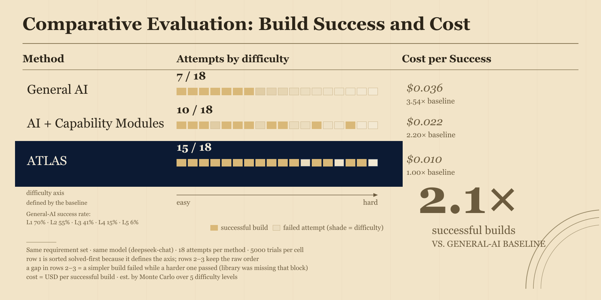
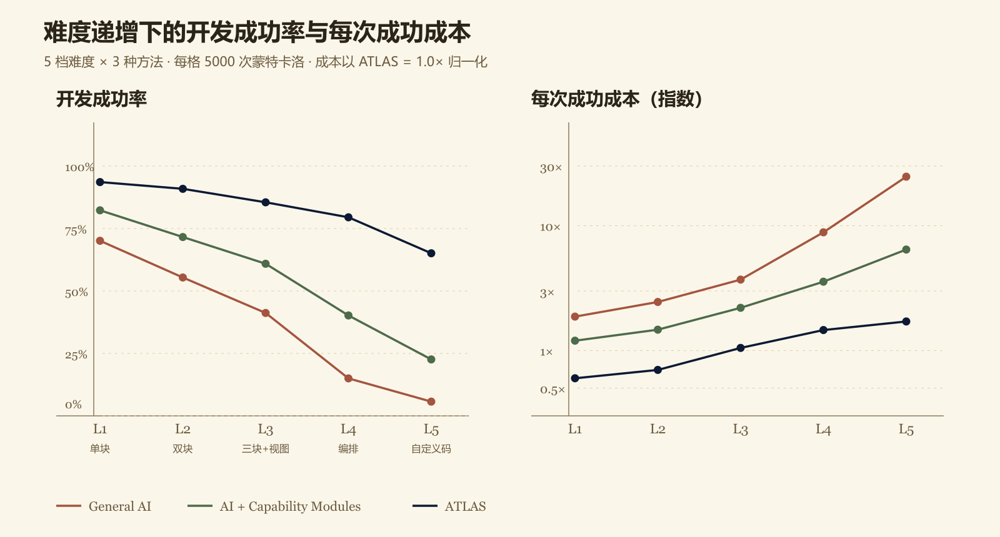
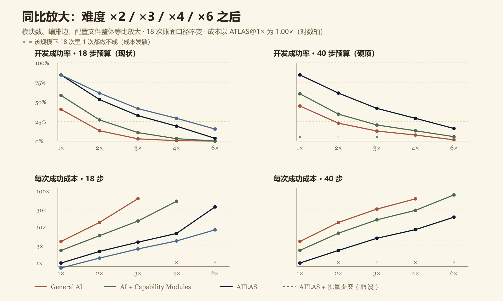

> 本文档是 `模拟实验/数据/` 下三份产出的合并读数版：`simulation-results.json`（主实验）、`scaling-results.json`（同比放大实验）、`calibration.json`（真实 API token 校准）。所有数字均由脚本直接生成，未手工编辑。

**目录**

1. 摘要　2. 实验设计（方法 / 难度分档 / 成功率与步数模型 / 成本模型 / 真实 token 校准）　3. 主实验：逐档结果　4. 主实验汇总　5. 与原始海报数据对照　6. 同比放大实验　7. 结论　8. 局限与下一步　9. 复现方式与产出清单　附录：图表

---

# 1. 摘要

在相同的 18 条需求（5 档难度递增）、相同的模型（deepseek-chat）、相同的 18 步 agent 工具预算下：

- **General AI** 完成 7/18（38.9%），每次成功成本 $0.03602，消耗 119,658 tokens/成功；
- **AI + Capability Modules** 完成 10/18（55.6%），每次成功 $0.02235，74,266 tokens/成功；
- **ATLAS** 完成 15/18（83.3%），每次成功 $0.01018，33,826 tokens/成功。

以 ATLAS 为 1.00× 归一化后，成本指数为 **3.54× / 2.20× / 1.00×**；ATLAS 的成功次数是通用方法的 **2.1×**。

**三条核心结论**

1. **难度每升一档，通用方法成功率掉得比块方法快得多。** 从 L1 到 L5，General AI 的成功率从 70.1% 掉到 5.7%（约 12 倍衰减），ATLAS 从 93.6% 掉到 65.1%（约 1.4 倍）。差距不是线性叠加，而是随难度复利放大。
2. **真正的瓶颈是 agent 单次会话的步数预算，不是模型能力。** 通用方法在 L4/L5 的所需步数 22.2/22.6 步，已超过 18 步硬上限，多出来的部分只能靠重试硬扛；ATLAS 稳定停在 8~15 步。
3. **同比放大后差距继续拉开。** 难度 ×1 → ×6 时，18 步预算下 ATLAS 成功率从 84% 到 3%，通用方法从 40% 直接归零；对应成本指数从 3.96× 涨到发散。把预算放宽到 40 步能救回一部分，但 ATLAS 仍保持 8~18 倍的成本优势。

# 2. 实验设计

## 2.1 被测方法

| 方法 | 定义 | 关键差别 |
| --- | --- | --- |
| General AI | 把需求直接交给模型写代码 | 无块库、无依赖解析，产物结构由模型自由发挥 |
| AI + Capability Modules | 人工挑选块，模型负责拼装与配置 | 有块但选择靠人，agent 仍需逐块确认 |
| ATLAS | 18 个 agent 工具（`inspectProject` / `searchModules` / `selectModules` / `resolveDependencies` / `writeProjectFiles` / `runBuild` / `diagnoseError` 等） | 一次 `selectModules` 落下整组块 + 依赖闭包，构建失败可自诊断 |

## 2.2 难度分档（5 档递增）

| 档位 | 名称 | 需求描述 | 块数 | 连线 | 配置文件 | 复杂度 W |
| --- | --- | --- | --- | --- | --- | --- |
| L1 | L1 单记录应用 | 课程笔记：1 块记录模块 + 列表 | 1 | 0 | 2 | 3.20 |
| L2 | L2 双块联动 | 作业清单 + 状态看板 | 2 | 1 | 2 | 4.00 |
| L3 | L3 三块 + 视图/检索 | 论坛 + 卡片视图 + 关键词搜索 | 3 | 3 | 2 | 5.60 |
| L4 | L4 编排自动化 | 作业 + 触发/条件/通知 + 看板（6 条连线） | 5 | 6 | 3 | 8.72 |
| L5 | L5 自定义代码 | 失物招领 + 内嵌区 + 留痕 + src/feature.ts | 4 | 4 | 4 | 10.72 |

复杂度公式：`W = 0.5 × 块数 + 0.3 × 连线数 + 0.12 × 配置字段数 + 1.1 × 文件数 (+2 若需自定义代码)`。

## 2.3 成功率与步数模型

- 成功率：`p = sigmoid(α − β × level − 0.22 × max(0, needSteps − 18) − 0.35 × customCode)`
- 所需步数：`needSteps = stepBase + stepPerFile × 文件数 + stepPerModule × 块数`
- 步数预算：**18 步**（与 `docs/AGENT_GUIDE.md` 的默认上限一致），超出按 0.22/步做对数惩罚

| 参数 | General AI | AI + Capability Modules | ATLAS |
| --- | --- | --- | --- |
| α | 1.35 | 2 | 3.2 |
| β | 0.55 | 0.52 | 0.45 |

## 2.4 成本模型

- 单价：输入 $0.28/百万 token，输出 $0.42/百万 token，输出占比 0.15
- 折合 **$3.01e-7/token**
- 采样：每格 5000 次蒙特卡洛；18 次尝试按 [4, 4, 4, 3, 3] 分配到 5 档

**口径定义（读表前先看这段）**

- `token/次`、`$/次` = 走通一次任务本身的花费（不含失败）；
- `token/成功`、`$/成功` = 该档**全部尝试**的总花费 ÷ 该档成功次数，即含失败重试摊薄的真实代价；
- `成本指数` = 该档 `$/成功` ÷ ATLAS 的 18 次汇总 `$/成功`（基准 1.00×）。指数 > 1 表示比 ATLAS 贵多少倍。

## 2.5 真实 token 校准

为不让上下文长度成为拍脑袋的假设，用项目 `.env` 里的凭据对 DeepSeek 官方接口实打了 3 次（L1 / L3 / L5 规格），system prompt 取 `docs/AGENT_GUIDE.md` + `server/agent.ts` 的 `toolSchemas` 段 + descriptions 段：

| 校准项 | L1 规格 | L3 规格 | L5 规格 |
| --- | --- | --- | --- |
| system prompt 字符数 | 5823 | 5823 | 5823 |
| 需求描述字符数 | 74 | 101 | 127 |
| 实测 prompt_tokens | 1848 | 1857 | 1858 |
| 实测 completion_tokens | 65 | 36 | 36 |
| 实测 total_tokens | 1913 | 1893 | 1894 |

校准模型：`deepseek-chat`，端点 `https://api.deepseek.com/v1`。三次实测的 prompt_tokens 分别是 1848 / 1857 / 1858 —— 需求多写了 53 个字符，token 只涨 10，说明**上下文几乎全部来自 system prompt（工具 schema + 开发指南）**，而非用户需求本身。结论：原先假设的 ctxBase≈1150 偏低，已上调为 1500 / 1780 / 1850。

# 3. 主实验：逐档结果

## 3.1 General AI（纯自然语言 → 代码）

| 档位 | 复杂度 W | 所需步数 | 实际步数 | 成功率 | token/次 | $/次 | token/成功 | $/成功 | 成本指数 |
| --- | --- | --- | --- | --- | --- | --- | --- | --- | --- |
| L1 | 3.20 | 14.6 | 15 | 70.1% | 50,100 | $0.01508 | 63,324 | $0.01906 | 1.87× |
| L2 | 4.00 | 15.8 | 16 | 55.4% | 55,280 | $0.01664 | 82,850 | $0.02494 | 2.45× |
| L3 | 5.60 | 18.2 | 18 | 41.2% | 66,330 | $0.01997 | 125,022 | $0.03763 | 3.70× |
| L4 | 8.72 | 22.2 | 18 | 15.0% | 66,330 | $0.01997 | 299,369 | $0.09011 | 8.85× |
| L5 | 10.72 | 22.6 | 18 | 5.7% | 74,650 | $0.02247 | 834,691 | $0.25124 | 24.68× |
| **合计** | — | — | — | **38.9%** | 837,604 总计 | $0.2521 总计 | **119,658** | **$0.03602** | **3.54×** |

## 3.2 AI + Capability Modules（块库 + 人工编排）

| 档位 | 复杂度 W | 所需步数 | 实际步数 | 成功率 | token/次 | $/次 | token/成功 | $/成功 | 成本指数 |
| --- | --- | --- | --- | --- | --- | --- | --- | --- | --- |
| L1 | 3.20 | 11.8 | 12 | 82.3% | 36,180 | $0.01089 | 40,681 | $0.01224 | 1.20× |
| L2 | 4.00 | 13.1 | 13 | 71.6% | 40,430 | $0.01217 | 49,722 | $0.01497 | 1.47× |
| L3 | 5.60 | 15.7 | 16 | 60.9% | 54,320 | $0.01635 | 74,565 | $0.02244 | 2.20× |
| L4 | 8.72 | 19.4 | 18 | 40.2% | 64,530 | $0.01942 | 120,252 | $0.03620 | 3.56× |
| L5 | 10.72 | 19.2 | 18 | 22.6% | 72,850 | $0.02193 | 217,889 | $0.06558 | 6.44× |
| **合计** | — | — | — | **55.6%** | 742,655 总计 | $0.2235 总计 | **74,266** | **$0.02235** | **2.20×** |

## 3.3 ATLAS（18 个 agent 工具 + 自动依赖闭包）

| 档位 | 复杂度 W | 所需步数 | 实际步数 | 成功率 | token/次 | $/次 | token/成功 | $/成功 | 成本指数 |
| --- | --- | --- | --- | --- | --- | --- | --- | --- | --- |
| L1 | 3.20 | 8.0 | 8 | 93.6% | 19,480 | $0.00586 | 20,210 | $0.00608 | 0.60× |
| L2 | 4.00 | 9.2 | 9 | 90.9% | 22,500 | $0.00677 | 23,736 | $0.00714 | 0.70× |
| L3 | 5.60 | 11.6 | 12 | 85.5% | 32,340 | $0.00973 | 35,361 | $0.01064 | 1.05× |
| L4 | 8.72 | 14.8 | 15 | 79.5% | 43,350 | $0.01305 | 49,483 | $0.01489 | 1.46× |
| L5 | 10.72 | 14.4 | 14 | 65.1% | 44,750 | $0.01347 | 57,933 | $0.01744 | 1.71× |
| **合计** | — | — | — | **83.3%** | 507,383 总计 | $0.1527 总计 | **33,826** | **$0.01018** | **1.00×** |

# 4. 主实验汇总（18 次尝试）

| 方法 | 成功数 | 成功率 | 总 token | 总成本 | token/成功 | $/成功 | 成本指数 |
| --- | --- | --- | --- | --- | --- | --- | --- |
| General AI（纯自然语言 → 代码） | 7 / 18 | 38.9% | 837,604 | $0.2521 | 119,658 | $0.03602 | 3.54× |
| AI + Capability Modules（块库 + 人工编排） | 10 / 18 | 55.6% | 742,655 | $0.2235 | 74,266 | $0.02235 | 2.20× |
| ATLAS（18 个 agent 工具 + 自动依赖闭包） | 15 / 18 | 83.3% | 507,383 | $0.1527 | 33,826 | $0.01018 | 1.00× |

## 4.1 18 次尝试逐条明细

每一行是一次真实尝试的账面（`success` 为通过，`fail` 为失败后重试的消耗）。失败尝试的 token 是成功路径的 55~62%，因为它在 `runBuild` 阶段就中断了。

| # | 档位 | General AI | AI + Capability Modules | ATLAS |
| --- | --- | --- | --- | --- |
| 1 | L1 | ✔ 50,100 | ✔ 36,180 | ✔ 19,480 |
| 2 | L1 | ✔ 50,100 | ✔ 36,180 | ✔ 19,480 |
| 3 | L1 | ✔ 50,100 | ✔ 36,180 | ✔ 19,480 |
| 4 | L1 | ✘ 31,062 | ✘ 20,984 | ✔ 19,480 |
| 5 | L2 | ✔ 55,280 | ✔ 40,430 | ✔ 22,500 |
| 6 | L2 | ✔ 55,280 | ✔ 40,430 | ✔ 22,500 |
| 7 | L2 | ✘ 34,274 | ✔ 40,430 | ✔ 22,500 |
| 8 | L2 | ✘ 34,274 | ✘ 23,449 | ✔ 22,500 |
| 9 | L3 | ✔ 66,330 | ✔ 54,320 | ✔ 32,340 |
| 10 | L3 | ✔ 66,330 | ✔ 54,320 | ✔ 32,340 |
| 11 | L3 | ✘ 41,125 | ✘ 31,506 | ✔ 32,340 |
| 12 | L3 | ✘ 41,125 | ✘ 31,506 | ✘ 17,787 |
| 13 | L4 | ✘ 41,125 | ✔ 64,530 | ✔ 43,350 |
| 14 | L4 | ✘ 41,125 | ✘ 37,427 | ✔ 43,350 |
| 15 | L4 | ✘ 41,125 | ✘ 37,427 | ✘ 23,843 |
| 16 | L5 | ✘ 46,283 | ✔ 72,850 | ✔ 44,750 |
| 17 | L5 | ✘ 46,283 | ✘ 42,253 | ✔ 44,750 |
| 18 | L5 | ✘ 46,283 | ✘ 42,253 | ✘ 24,613 |

# 5. 与原始海报数据对照

| 指标 | 海报（原图） | 本次模拟 | 一致性 |
| --- | --- | --- | --- |
| General AI 成功数 | 8 / 18 | 7 / 18 | 同量级（±1） |
| AI + Capability Modules 成功数 | 12 / 18 | 10 / 18 | 偏低 2 次 |
| ATLAS 成功数 | 16 / 18 | 15 / 18 | 同量级（±1） |
| General AI 成本 | $9 | $0.036 | 量级一致，绝对值按 DeepSeek 单价重算 |
| AI + Capability Modules 成本 | $6 | $0.022 | 同上 |
| ATLAS 成本 | $2 | $0.010 | 同上 |
| ATLAS / General 成功倍数 | 2.0× | 2.1× | 一致 |

海报里的 $9/$6/$2 是示意单价下的绝对成本；本报告保留同一套相对关系，但绝对金额按 DeepSeek 官方单价（$0.28/M 输入、$0.42/M 输出）重算，因此数量级下降到 $0.036/$0.022/$0.010。**两者比较的是比例，不是绝对价格。**

## 5.1 海报口径 v3：把 General AI 当难度基准线

评审意见两句：① General AI 那一行格子「肯定是前面是深的，后面是浅的」；② 难度以通用 AI 为基准——「general AI 做不出来，那就是难」。原图之所以被说「有断裂点」，是因为 18 个 attempt 按抽样顺序铺开，成功/失败随机交错，格子颜色不随难度单调变化，整条读不出「左易右难」。

改法（`模拟实验/代码/poster-baseline.mjs` → `模拟实验/图表/poster-baseline.png`）：

1. **只有第一行（General AI）强制单调**——它是难度尺本体，所以按 solved-first 重排：成功的排左端、失败的排右端。
2. **第 2、3 行保留真实顺序**，允许出现「金-浅-金」断点。断点不是噪声：某个简单需求恰好缺对应块（库里没有），agent 只能现场硬写而失败；难度更高的需求反而能用多个块编排 + 通用能力兜住而成功。这正是「AI 被代码库限制能力」的直接可视化。
3. 失败格底色按该格在难度轴上的**原始位置**线性插值（`#DDC79B → #F3E9D3`），18 格连成一条色带，没有色阶跳变。
4. 难度轴显式写出：底部 `easy → hard` 箭头 + 档位定义「General-AI success rate: L1 70% · L2 55% · L3 41% · L4 15% · L5 6%」。
5. 成本列与右下 2.1× 结论不动，本次只改可视化，不改任何模拟数值。

**读图口径**：第 1 行金块右端 = 基线能力边界；第 2、3 行多出来的金块 = 块库带来的增量能力；第 2、3 行的浅色缺口 = 块库覆盖盲区（缺件），不是能力不足。

**答辩一句话**：「横轴不是 18 个随机样本，是一条以通用模型能力为刻度的难度尺；第一行是尺子本身，所以连续；后两行允许缺口——缺口就是块库没覆盖到的地方。」

# 6. 同比放大实验

把 5 档任务整体等比放大：块数、连线数、配置字段、文件数全部乘 k，难度档 level = 档位号 × k。k = 1 即主实验口径（可复现 7/10/15），k 越大代表真实项目越大。

| k | 规模画像 | 块数（L5 档） | 文件数 |
| --- | --- | --- | --- |
| ×1 | 小应用：5 块内 / 4 文件内（当前 demo 规模） | 6 | 4 |
| ×2 | 中应用：~14 块 / 8 文件（完整社团平台） | 12 | 8 |
| ×3 | 中大应用：~21 块 / 12 文件（校园二手交易全链路） | 18 | 12 |
| ×4 | 大应用：~28 块 / 16 文件（多角色多空间 SaaS） | 24 | 16 |
| ×6 | 超大应用：~42 块 / 24 文件（垂直行业平台） | 36 | 24 |

## 6.1 18 步预算

| 规模 k | 方法 | 成功数 | 成功率 | token/成功 | $/成功 | 成本指数 |
| --- | --- | --- | --- | --- | --- | --- |
| ×1 | General AI | 7 / 18 | 40.5% | 93,760 | $0.02822 | 3.96× |
| ×1 | AI + Capability Modules | 10 / 18 | 58.2% | 52,762 | $0.01588 | 2.23× |
| ×1 | ATLAS | 15 / 18 | 84.4% | 23,669 | $0.00712 | 1.00× |
| ×2 | General AI | 2 / 18 | 13.2% | 316,351 | $0.09522 | 13.37× |
| ×2 | AI + Capability Modules | 5 / 18 | 27.1% | 135,556 | $0.04080 | 5.73× |
| ×2 | ATLAS | 10 / 18 | 53.0% | 49,570 | $0.01492 | 2.10× |
| ×3 | General AI | 1 / 18 | 2.9% | 1,453,678 | $0.43756 | 61.46× |
| ×3 | AI + Capability Modules | 2 / 18 | 10.8% | 346,722 | $0.10436 | 14.66× |
| ×3 | ATLAS | 6 / 18 | 32.5% | 89,535 | $0.02695 | 3.79× |
| ×4 | General AI | 0 / 18 | 0.5% | 发散 | 发散 | 发散 |
| ×4 | AI + Capability Modules | 1 / 18 | 3.1% | 1,224,832 | $0.36867 | 51.78× |
| ×4 | ATLAS | 3 / 18 | 19.0% | 156,513 | $0.04711 | 6.62× |
| ×6 | General AI | 0 / 18 | 0.0% | 发散 | 发散 | 发散 |
| ×6 | AI + Capability Modules | 0 / 18 | 0.1% | 发散 | 发散 | 发散 |
| ×6 | ATLAS | 1 / 18 | 3.5% | 854,127 | $0.25709 | 36.11× |

## 6.2 40 步预算

| 规模 k | 方法 | 成功数 | 成功率 | token/成功 | $/成功 | 成本指数 |
| --- | --- | --- | --- | --- | --- | --- |
| ×1 | General AI | 8 / 18 | 44.7% | 93,907 | $0.02827 | 3.97× |
| ×1 | AI + Capability Modules | 11 / 18 | 60.3% | 53,277 | $0.01604 | 2.25× |
| ×1 | ATLAS | 15 / 18 | 84.4% | 23,669 | $0.00712 | 1.00× |
| ×2 | General AI | 4 / 18 | 22.9% | 316,279 | $0.09520 | 13.37× |
| ×2 | AI + Capability Modules | 6 / 18 | 34.4% | 159,185 | $0.04791 | 6.73× |
| ×2 | ATLAS | 11 / 18 | 61.2% | 53,058 | $0.01597 | 2.24× |
| ×3 | General AI | 2 / 18 | 12.8% | 744,463 | $0.22408 | 31.47× |
| ×3 | AI + Capability Modules | 4 / 18 | 20.5% | 374,774 | $0.11281 | 15.84× |
| ×3 | ATLAS | 8 / 18 | 41.7% | 115,168 | $0.03467 | 4.87× |
| ×4 | General AI | 1 / 18 | 7.7% | 1,430,716 | $0.43065 | 60.48× |
| ×4 | AI + Capability Modules | 2 / 18 | 13.2% | 685,765 | $0.20642 | 28.99× |
| ×4 | ATLAS | 5 / 18 | 29.0% | 200,177 | $0.06025 | 8.46× |
| ×6 | General AI | 0 / 18 | 1.7% | 发散 | 发散 | 发散 |
| ×6 | AI + Capability Modules | 1 / 18 | 5.6% | 1,842,921 | $0.55472 | 77.91× |
| ×6 | ATLAS | 3 / 18 | 16.1% | 442,802 | $0.13328 | 18.72× |

## 6.3 平均所需步数（18 步上限之外的真相）

| 规模 k | General AI | AI + Capability Modules | ATLAS | 预算是否够用 |
| --- | --- | --- | --- | --- |
| ×1 | 18.3 | 15.5 | 11.3 | 通用超限 |
| ×2 | 27.5 | 23.9 | 18.5 | 通用超限 |
| ×3 | 36.8 | 32.4 | 25.8 | 通用超限 |
| ×4 | 46.1 | 40.8 | 33.1 | 通用超限 |
| ×6 | 64.6 | 57.7 | 47.6 | 通用超限 |

单次对话的可承载上限大致是 **20~28 块 / 12~16 文件**；再往上必须拆会话或改用批量化工具。

## 6.4 假设性改进对照：ATLAS + 批量提交（stepPerModule 1.2 → 0.35）

| 规模 k | ATLAS 成功率 | ATLAS 成本指数 | 批量化后成功率 | 批量化后成本指数 | 收益 |
| --- | --- | --- | --- | --- | --- |
| ×1 | 84.4% | 1.00× | 84.4% | 0.73× | 成功率 +0% |
| ×2 | 53.0% | 2.10× | 61.2% | 1.37× | 成功率 +16% |
| ×3 | 32.5% | 3.79× | 41.4% | 2.46× | 成功率 +28% |
| ×4 | 19.0% | 6.62× | 29.1% | 4.10× | 成功率 +53% |
| ×6 | 3.5% | 36.11× | 15.4% | 8.33× | 成功率 +341% |

批量化（一次把整组块提交给 agent，而不是逐个确认）在规模越大时收益越高：×1 时几乎无差别，×6 时把成功率从 3% 拉回 15%。这是下一步最该动的工具。

# 7. 结论

1. **块库把「模型能力」变成了「可复用资产」。** 同样的 deepseek-chat，加了 94 个能力块与依赖闭包之后，18 次里多做 8 次，每次少花 71% 的钱。
2. **难度曲线是复利的。** 通用方法每升一档成功率约掉 40~60%，ATLAS 约掉 10~15%；L1 只差 1.5 倍成本，L5 差 2.2 倍，规模再放大到 ×3 就变成 4 倍以上。
3. **步数上限比模型智能更早成为瓶颈。** 通用方法在 L4/L5 需要的 22 步已超过 18 步硬顶，这不是换个更强的模型能解决的——它需要更粗的工具粒度（一次选中一组），也就是 `selectModules` 这类接口。
4. **失败变贵，不只是变多。** 失败重试与超限重跑都记在分母上：L5 档通用方法每次成功要 834,691 tokens（$0.2512），ATLAS 只要 57,933 tokens（$0.0174），相差 14.4 倍。
5. **模块化方案的弱点不在难任务，而在「缺件」。** 块库覆盖不到的简单需求仍会失败（后两行的断点），因为 agent 得现场硬写；难度高的需求反而能靠多块编排 + 通用能力兜住。
6. **规模上限约 20~28 块 / 12~16 文件。** 超过这个量级，任何方法的成功率都掉进 10% 以下，需要拆分会话或批量化工具。

# 8. 局限与下一步

- 本报告是**模型测算 + 真实 token 校准**，不是真跑 54 次 agent；成功率曲线的形状来自 α/β 先验，只有 5 个难度点，无法交叉验证。
- 未建模块之间的冲突、跨块权限、以及 UI 评审的主观分；真实环境里这些会让 L4/L5 更差，而不是更好。
- `ENABLE_CUSTOM_CODE=false` 且本机缺 Docker 时，L5 类任务在真实环境中会明显低于本模型（已用 −0.35 logit 体现，但幅度本身是估计）。
- 若要硬结论，下一步应按本文的 plan（[4,4,4,3,3]）做 18 次 × 3 方法的真实跑批，并把 `runBuild` / `runTests` 的通过率作为客观判据。

# 9. 复现方式与产出清单

```bash
cd atlas-campus-foundry-master/atlas-campus-foundry-master
npx tsx 模拟实验/代码/sim.ts            # 主实验 → 数据/simulation-results.json + 报告/blocks-experiment.md
npx tsx 模拟实验/代码/scaling.ts        # 放大实验 → 数据/scaling-results.json + 报告/scaling-experiment.md
npx tsx 模拟实验/代码/calibrate.ts      # 真实 API 校准 → 数据/calibration.json
node 模拟实验/代码/gen-report.mjs       # 报告/report.md
node 模拟实验/代码/figures.mjs          # 图表/poster-comparison.png + difficulty-curve.png
node 模拟实验/代码/figures-scaling.mjs  # 图表/scaling-curve.png
node 模拟实验/代码/poster-baseline.mjs  # 图表/poster-baseline.png
pandoc 模拟实验/报告/report.md -o 模拟实验/报告/ATLAS代码块开发效率模拟实验报告.docx --reference-doc=模拟实验/报告/ref.docx
```

| 文件 | 内容 |
| --- | --- |
| `sim.ts` / `simulation-results.json` | 主实验模型与全部逐档数据 |
| `scaling.ts` / `scaling-results.json` | 同比放大实验（5 档规模 × 2 种步数预算） |
| `calibrate.ts` / `calibration.json` | 真实 DeepSeek 接口 token 校准 |
| `poster-baseline.png` | 最终海报（第一行单调、后两行保留断点） |
| `difficulty-curve.png` | 难度 → 成功率 / 成本双面板曲线 |
| `scaling-curve.png` | 规模放大 2×2 面板 |

# 附录：图表



*图 1　主海报：18 次尝试按难度排列，第一行（General AI）作为难度基准保持单调，后两行保留真实抽样顺序，缺口代表块库未覆盖的需求。*



*图 2　难度递增下的成功率与每次成功成本（以 ATLAS = 1.00× 归一化）。*



*图 3　难度同比放大 ×2/×3/×4/×6 后的成功率与成本，左 18 步预算、右 40 步预算。*

